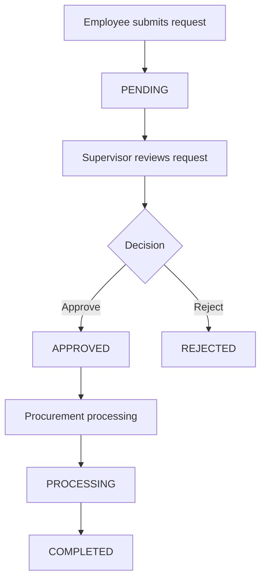
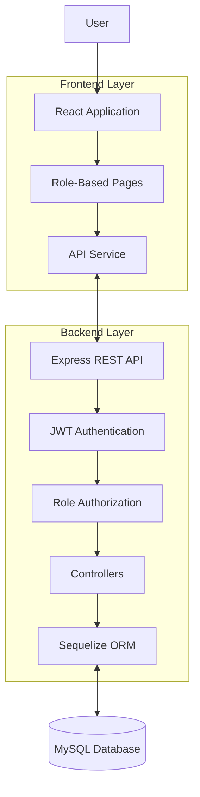

# IT Procurement Request Management System

A full-stack web application for managing IT procurement requests, approval workflows, procurement processing, and administrative monitoring.

**Repository:** [it-procurement-request-system](https://github.com/sabasthian/it-procurement-request-system)

## Overview

The IT Procurement Request Management System centralizes the process of requesting, reviewing, approving, and tracking IT equipment procurement.

The application provides role-based dashboards for Employees, Supervisors, Procurement Staff, and Administrators. Each role has access to specific features based on its responsibilities.

This project demonstrates full-stack web development, REST API integration, relational database management, authentication, authorization, and workflow management.

## Key Features

### Authentication and Access Control
- User login with credential verification.
- JWT-based authentication for protected API endpoints.
- Role-based access control (RBAC).
- Middleware for authentication and authorization.
- Password hashing support using bcryptjs.

### Employee Dashboard
- Create IT procurement requests.
- View request details and current status.
- Search and filter procurement requests.
- Track the progress of submitted requests.

### Supervisor Dashboard
- Review pending procurement requests.
- Approve or reject requests.
- Provide a rejection reason.
- Receive feedback notifications for relevant actions.

### Procurement Dashboard
- View requests that have been approved.
- Process procurement requests.
- Update procurement progress.
- Mark requests as completed.

### Administrator Dashboard
- Monitor registered users and procurement requests.
- View dashboard statistics.
- Manage user roles.
- Activate or deactivate user accounts.
- Search and filter records for monitoring.
- Apply administrative access restrictions to management endpoints.

## Technology Stack

| Category | Technology |
|---|---|
| Frontend framework | React |
| Frontend tooling | Vite |
| Programming language | JavaScript (ES6+) |
| Client-side routing | React Router DOM |
| Styling | CSS |
| Backend runtime | Node.js |
| Backend framework | Express.js |
| API architecture | REST API |
| Database | MySQL |
| ORM | Sequelize |
| Authentication | JSON Web Token (JWT) |
| Password hashing | bcryptjs |
| Environment configuration | dotenv |
| Cross-origin configuration | CORS |
| Development utility | Nodemon |
| Package manager | npm |
| Version control | Git and GitHub |
| API testing | Postman |

## User Roles and Permissions

| Role | Main Responsibilities |
|---|---|
| Employee | Submit requests, view details, and track status |
| Supervisor | Review, approve, or reject requests |
| Procurement | Process approved requests and complete procurement |
| Administrator | Monitor the system and manage users |

Access to protected operations is controlled through authentication and role-based authorization on the backend.

## Procurement Workflow

The application implements a procurement status workflow.



### Status Definitions

- **PENDING:** The request is awaiting a supervisor's decision.
- **APPROVED:** The request has been approved for procurement.
- **REJECTED:** The request has been rejected by a supervisor.
- **PROCESSING:** Procurement processing is underway.
- **COMPLETED:** The request has reached completion.

Rejected requests follow a separate outcome from the approved procurement workflow.

## System Architecture

The application follows a frontend-backend-database architecture.



### Request Processing

1. A user interacts with the React frontend.
2. The frontend sends HTTP requests to the Express API.
3. Authentication middleware validates access tokens for protected endpoints.
4. Authorization middleware checks permissions for restricted operations.
5. Controllers execute application logic.
6. Sequelize interacts with the MySQL database.
7. API responses are returned to the frontend.

## Project Structure

```text
IT-Procurement-System/
├── backend/
│   ├── src/
│   │   ├── config/
│   │   │   └── database.js
│   │   ├── controllers/
│   │   │   ├── adminController.js
│   │   │   ├── authController.js
│   │   │   └── procurementController.js
│   │   ├── middleware/
│   │   │   └── authMiddleware.js
│   │   ├── models/
│   │   │   ├── ProcurementRequest.js
│   │   │   └── User.js
│   │   ├── routes/
│   │   │   ├── adminRoutes.js
│   │   │   ├── authRoutes.js
│   │   │   └── procurementRoutes.js
│   │   └── app.js
│   ├── server.js
│   └── package.json
├── frontend/
│   ├── src/
│   │   ├── pages/
│   │   ├── services/
│   │   ├── App.jsx
│   │   ├── App.css
│   │   ├── index.css
│   │   └── main.jsx
│   ├── public/
│   ├── index.html
│   └── package.json
├── .gitignore
├── package.json
├── package-lock.json
└── README.md
```

## Installation and Setup

### Prerequisites

Install the following tools before running the application:

- Node.js and npm
- MySQL Server
- Git
- A code editor such as IntelliJ IDEA or Visual Studio Code
- Postman (optional, for API testing)

### 1. Clone the Repository

```bash
git clone https://github.com/sabasthian/it-procurement-request-system.git
cd it-procurement-request-system
```

### 2. Configure the Backend

```bash
cd backend
npm install
```

Create a `.env` file inside the `backend` directory. Configure the environment variables expected by the backend application.

Example configuration:

```env
PORT=5000
DB_HOST=localhost
DB_PORT=3306
DB_NAME=it_procurement_db
DB_USER=your_mysql_username
DB_PASSWORD=your_mysql_password
JWT_SECRET=replace_with_a_strong_random_secret
```

Use your own local database credentials and a strong JWT secret. Never commit the actual `.env` file.

### 3. Configure the Database

Create the MySQL database:

```sql
CREATE DATABASE it_procurement_db;
```

Ensure that the database connection configuration and Sequelize model initialization match the existing backend implementation before starting the server.

### 4. Start the Backend

From the `backend` directory, run:

```bash
npm run dev
```

The backend is configured for local development on port `5000`.

### 5. Install and Start the Frontend

Open another terminal at the project root:

```bash
cd frontend
npm install
npm run dev
```

The Vite development server typically runs at:

`http://localhost:5173`

The frontend API configuration should point to the backend at:

`http://localhost:5000`

Check the existing frontend API service and backend configuration if either port differs in your environment.

## API Overview

The backend organizes its routes into the following API groups.

| Base path | Purpose |
|---|---|
| `/api/auth` | Authentication |
| `/api/requests` | Procurement request operations |
| `/api/admin` | Administrative operations |

Known administrative endpoints include:

- `GET /api/admin/users` — retrieve user records.
- `PATCH /api/admin/users/:id/toggle-status` — activate or deactivate a user.
- `PATCH /api/admin/users/:id/role` — update a user's role.

Administrative operations are protected by role-based authorization.

For complete API documentation, HTTP methods, request bodies, and response examples, refer to the corresponding route and controller files in the backend.

## Security Considerations

- Keep `.env` files out of version control.
- Never publish database passwords, JWT secrets, or access tokens.
- Use password hashing rather than storing plain-text passwords.
- Protect sensitive endpoints with authentication and authorization middleware.
- Validate incoming request data and handle errors appropriately.
- Configure CORS according to the deployment environment.
- Review all configuration and dependencies before production deployment.

## Project Objectives

- Centralize IT procurement requests.
- Establish a structured approval and rejection workflow.
- Improve procurement status visibility.
- Enforce role-based access control.
- Support user management and administrative monitoring.
- Demonstrate practical full-stack development and database integration.

## Current Project Scope

This repository contains the frontend and backend source code for local development. Production deployment, automated testing, and additional enterprise features should be documented only after they have been implemented and verified.

## License

No open-source license has been added to this repository yet. Unless a license is added, standard copyright restrictions apply to reuse and redistribution.

---

**Project:** IT Procurement Request Management System  
**Repository:** [GitHub](https://github.com/sabasthian/it-procurement-request-system)